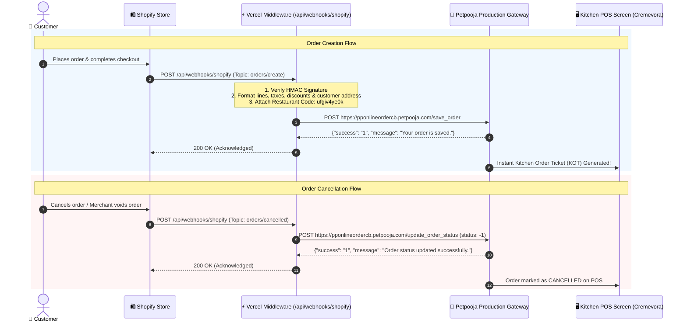

# 🍰 Shopify ➔ Petpooja Direct POS Sync
### *Real-Time Order Relay Middleware for Cremevora: Luxury Cakes, Mindfully Crafted*

[](https://nextjs.org/)
[](https://www.typescriptlang.org/)
[](https://vercel.com/)
[](https://developerapi.petpooja.com/)
[](https://shopify.dev/)

An ultra-fast, stateless, serverless middleware connecting online orders placed on **Shopify** directly into physical **Petpooja Restaurant POS** screens and Kitchen Display Systems (KDS) in real-time.

---

## ⚡ The Pure 4-Technology Architecture

This integration strictly operates using **only four technologies**—eliminating external databases, message queues, Docker, and polling containers:

```
┌─────────────┐       ┌──────────────┐       ┌─────────────┐       ┌──────────────┐
│   Shopify   │  ──>  │    Vercel    │  ──>  │  Petpooja   │  ──>  │ Petpooja POS │
│  Storefront │       │  Serverless  │       │ API Gateway │       │   Terminal   │
└─────────────┘       └──────────────┘       └─────────────┘       └──────────────┘
```

1. **Shopify**: Captures customer orders and dispatches signed real-time webhooks (`orders/create`, `orders/updated`, `orders/cancelled`).
2. **Vercel**: Executes stateless, edge-speed Next.js serverless functions with zero database lag.
3. **GitHub**: Automates Continuous Integration & Deployment (CI/CD) on every push to `main`.
4. **Petpooja**: Receives transformed orders on `/save_order` and cancellations on `/update_order_status`, rendering them directly on kitchen screens.

---

## 🏗️ Architectural Flow



---

## 🌐 Live Production Deployment Details

- **Production Base URL**: `https://petpooja-middleware1.vercel.app`
- **GitHub Repository**: [`ABVicky/MiddleWare---PetPoojaxShopify-Creamvora-`](https://github.com/ABVicky/MiddleWare---PetPoojaxShopify-Creamvora-)
- **Brand / Restaurant Name**: `Cremevora`
- **Petpooja Restaurant ID**: `451593`
- **Petpooja Restaurant Code (`restid`)**: `ufgiv4ye0k` *(Used as `restid` in all API calls)*

---

## 🔌 API Endpoints Reference

### 1. Inbound Middleware Endpoints (Hosted on Vercel)

| Endpoint | Method | Source | Purpose |
| :--- | :---: | :---: | :--- |
| `/api/webhooks/shopify` | `POST` | Shopify | Ingests `orders/create`, `orders/updated`, and `orders/cancelled`, validates HMAC, and relays to Petpooja. |
| `/api/petpooja/get-status` | `POST` | Petpooja | Petpooja heartbeat polling (returns `"status": "1"` - Online). |
| `/api/petpooja/order-callback` | `POST` | Petpooja | Receives order lifecycle updates (Accept, Food Ready, Dispatched, Cancel). |
| `/api/petpooja/update-order-status` | `POST` | Internal/API | Manual or programmatic order cancellation relay to Petpooja. |
| `/api/petpooja/rider-status` | `POST` | Internal/API | Dispatches delivery executive & rider details to Petpooja. |
| `/api/petpooja/update-status` | `POST` | Petpooja | Allows POS manager to toggle store open/close state. |
| `/api/petpooja/menu-push` | `POST` | Petpooja | Receives catalog menu updates from Petpooja. |
| `/api/petpooja/item-on` | `POST` | Petpooja | Signals that an out-of-stock item is back in stock. |
| `/api/petpooja/item-off` | `POST` | Petpooja | Signals that an item has been toggled out of stock at POS. |

### 2. Petpooja Production Target Endpoints

| Operation | Method | Target Production Endpoint |
| :--- | :---: | :--- |
| **Order Relay** | `POST` | `https://pponlineordercb.petpooja.com/save_order` |
| **Order Status Update (Cancel)** | `POST` | `https://pponlineordercb.petpooja.com/update_order_status` |
| **Rider Status Update** | `POST` | `https://pponlineordercb.petpooja.com/rider_status_update` |

---

## ⚙️ Configuration & Environment Variables

### Environment Variables in Vercel

Configured in your **Vercel Project Dashboard** ➔ **Settings** ➔ **Environment Variables**:

| Variable | Description | Setting / Value |
| :--- | :--- | :--- |
| `APP_URL` | Live middleware base URL | `https://petpooja-middleware1.vercel.app` |
| `PETPOOJA_ENV` | Target API Environment | `production` |
| `PETPOOJA_APP_KEY` | Petpooja Developer API Key | `iksfvd458an7y91etcmqo0jph6wrxbg3` |
| `PETPOOJA_APP_SECRET` | Petpooja Developer API Secret | `a36bed2ad5c3a821948a29c60ec53bb4d4df0051` |
| `PETPOOJA_ACCESS_TOKEN` | Petpooja API Access Token | `f756c3e36c915db29339bc8b139bfdd2f4abf4e3` |
| `PETPOOJA_REST_ID` | Petpooja Restaurant Code (`restid`) | `ufgiv4ye0k` |
| `PETPOOJA_RESTAURANT_ID` | Petpooja Restaurant ID | `451593` |
| `PETPOOJA_RESTAURANT_NAME` | Restaurant Brand Name | `Cremevora` |
| `PETPOOJA_ORDER_API_URL` | Production Order Relay URL | `https://pponlineordercb.petpooja.com/save_order` |
| `PETPOOJA_UPDATE_ORDER_STATUS_URL`| Production Order Cancel URL | `https://pponlineordercb.petpooja.com/update_order_status` |
| `PETPOOJA_RIDER_STATUS_URL` | Production Rider Status URL | `https://pponlineordercb.petpooja.com/rider_status_update` |
| `SHOPIFY_WEBHOOK_SECRET` | Shopify HMAC Webhook signing secret | *(From Shopify Notifications -> Webhooks)* |
| `DEFAULT_ORDER_TYPE` | Default Petpooja order type | `Delivery` |

---

## 🚀 Setup Instructions

### 1. Configure Shopify Webhooks
1. Open your **Shopify Store Admin**.
2. Navigate to **Settings** ➔ **Notifications** ➔ Scroll down to **Webhooks**.
3. Create Webhook for Order Creation:
   - **Event**: `Order creation`
   - **Format**: `JSON`
   - **URL**: `https://petpooja-middleware1.vercel.app/api/webhooks/shopify`
   - **Webhook API Version**: `Latest`
4. Create Webhook for Order Cancellation:
   - **Event**: `Order cancellation`
   - **Format**: `JSON`
   - **URL**: `https://petpooja-middleware1.vercel.app/api/webhooks/shopify`
   - **Webhook API Version**: `Latest`

### 2. Configure Petpooja Developer Portal
1. Log in to the [Petpooja Developer Portal](https://developerapi.petpooja.com/developers/configuration/).
2. Fill in the callback endpoints:
   - **Base URL**: `https://petpooja-middleware1.vercel.app`
   - **Get Store Status API Endpoint**: `/api/petpooja/get-status`
   - **Update Store Status API Endpoint**: `/api/petpooja/update-status`
   - **Menu Sharing Endpoint**: `/api/petpooja/menu-push`
   - **Item Off API Endpoint**: `/api/petpooja/item-off`
   - **Item On API Endpoint**: `/api/petpooja/item-on`
   - **Enable Order Relay**: Check `[x]`
3. Click **Save Configurations**.

---

## 🧪 Live Verification & Testing

### 1. Test Store Status Heartbeat
```bash
curl -X POST https://petpooja-middleware1.vercel.app/api/petpooja/get-status \
  -H "Content-Type: application/json" \
  -d '{"restID": "ufgiv4ye0k"}'
```
**Response:**
```json
{"success":"1","restID":"ufgiv4ye0k","status":"1","message":"Store is ONLINE"}
```

### 2. Test Order Creation Relay
```bash
curl -X POST https://petpooja-middleware1.vercel.app/api/webhooks/shopify \
  -H "Content-Type: application/json" \
  -H "x-shopify-webhook-id: test-order-1001" \
  -H "x-shopify-topic: orders/create" \
  -d '{
    "id": 9988776655,
    "name": "#TEST-1001",
    "order_number": 1001,
    "email": "customer@cremevora.com",
    "phone": "+919876543210",
    "created_at": "2026-10-23T11:30:00+05:30",
    "financial_status": "paid",
    "currency": "INR",
    "total_price": "1250.00",
    "subtotal_price": "1200.00",
    "total_tax": "50.00",
    "tax_lines": [{"title": "GST", "price": "50.00", "rate": 0.05}],
    "payment_gateway_names": ["Razorpay"],
    "shipping_address": {
      "first_name": "Aarav",
      "last_name": "Sharma",
      "phone": "+919876543210",
      "address1": "Flat 402, Sunshine Heights, Linking Road",
      "city": "Mumbai",
      "province": "Maharashtra",
      "zip": "400050",
      "country": "India"
    },
    "line_items": [{
      "id": 1122334455,
      "title": "Belgian Dark Chocolate Truffle Cake (500g)",
      "sku": "CAKE-CHOC-500",
      "quantity": 1,
      "price": "1200.00",
      "tax_lines": [{"title": "GST", "price": "50.00", "rate": 0.05}]
    }]
  }'
```
**Response:**
```json
{
  "success": true,
  "message": "Order directly synced and relayed to Petpooja POS",
  "clientOrderID": "1001",
  "status": "SYNCED_TO_PETPOOJA"
}
```

---

## 🛡️ Security & PCI Compliance

- **HMAC Verification**: Ingested webhooks are cryptographically validated using SHA-256 HMAC and `crypto.timingSafeEqual`.
- **PII Redaction**: Customer emails, phone numbers, and internal secrets are scrubbed in application logging outputs.
- **Stateless Relay**: Customer payment details (credit cards, UPI IDs) are never stored on external disks or databases, operating in volatile serverless memory only.

---

## 📦 Project Structure

```
.
├── app/
│   ├── api/
│   │   ├── petpooja/
│   │   │   ├── get-status/            # Store online heartbeat check
│   │   │   ├── update-status/         # POS store toggle
│   │   │   ├── order-callback/        # Order lifecycle callback receiver
│   │   │   ├── update-order-status/   # Order status update & cancel relay
│   │   │   ├── rider-status/          # Rider delivery status relay
│   │   │   ├── menu-push/             # Catalog menu sync
│   │   │   ├── item-on/               # In-stock toggle
│   │   │   └── item-off/              # Out-of-stock toggle
│   │   └── webhooks/shopify/          # Shopify direct webhook receiver
│   ├── layout.tsx
│   └── page.tsx                       # Live middleware health check page
├── src/
│   ├── integrations/
│   │   ├── petpooja/                  # Petpooja Client, Types, Schemas, Mapper
│   │   └── shopify/                   # Shopify Webhook Verifier, Types, Schemas
│   ├── lib/                           # Logger, redaction, error handling
│   └── services/                      # Decimal.js billing & GST calculator
└── docs/                              # Integration specs and documentation
```

---

*Engineered with precision for **Cremevora: Luxury Cakes, Mindfully Crafted**.*

