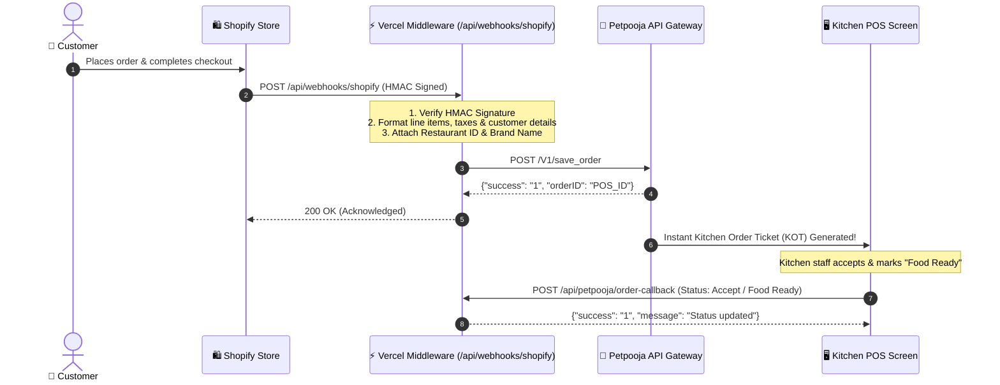

# 🍰 Shopify ➔ Petpooja Direct POS Sync
### *Real-Time Order Relay Middleware for Cremevora: Luxury Cakes, Mindfully Crafted*

[](https://nextjs.org/)
[](https://www.typescriptlang.org/)
[](https://vercel.com/)
[](https://developerapi.petpooja.com/)
[](https://shopify.dev/)

A ultra-fast, stateless, serverless middleware connecting online orders placed on **Shopify** directly into physical **Petpooja Restaurant POS** screens and Kitchen Display Systems (KDS) within milliseconds.

---

## ⚡ The Pure 4-Technology Architecture

This integration strictly operates using **only four technologies**—eliminating external databases, message queues, Docker, and polling containers:

```
┌─────────────┐       ┌──────────────┐       ┌─────────────┐       ┌──────────────┐
│   Shopify   │  ──>  │    Vercel    │  ──>  │  Petpooja   │  ──>  │ Petpooja POS │
│  Storefront │       │  Serverless  │       │ API Gateway │       │   Terminal   │
└─────────────┘       └──────────────┘       └─────────────┘       └──────────────┘
```

1. **Shopify**: Captures customer orders and dispatches signed real-time webhooks.
2. **Vercel**: Executes stateless, edge-speed Next.js serverless functions with zero database lag.
3. **GitHub**: Automates Continuous Integration & Deployment (CI/CD) on every push.
4. **Petpooja**: Receives transformed orders on `/save_order` and renders them directly on kitchen screens.

---

## 🏗️ Architectural Flow



---

## 🌐 Live Production Deployment

- **Production Domain**: `https://petpooja-middleware1.vercel.app`
- **GitHub Repository**: [`ABVicky/MiddleWare---PetPoojaxShopify-Creamvora-`](https://github.com/ABVicky/MiddleWare---PetPoojaxShopify-Creamvora-)
- **Brand / Restaurant**: `Cremevora`
- **Petpooja Restaurant ID**: `451593`
- **Restaurant Code (`restid`)**: `ufgiv4ye0k`

---

## 🔌 API Endpoints Reference

### 1. Inbound Middleware Endpoints (Hosted on Vercel)
All endpoints run as serverless routes on Vercel:

| Endpoint | Method | Source | Purpose |
| :--- | :---: | :---: | :--- |
| `/api/webhooks/shopify` | `POST` | Shopify | Receives new order & cancellation notifications, validates HMAC, and relays to Petpooja. |
| `/api/petpooja/order-callback` | `POST` | Petpooja | Receives order lifecycle updates (Accept, Food Ready, Dispatched, Cancel). |
| `/api/petpooja/update-order-status` | `POST` | Internal/Shopify | Relays order cancellation updates to Petpooja `/update_order_status`. |
| `/api/petpooja/rider-status` | `POST` | Internal/Partner | Relays rider & delivery updates to Petpooja `/rider_status_update`. |
| `/api/petpooja/get-status` | `POST` | Petpooja | Store heartbeat check (returns `"status": "1"` - Online). |
| `/api/petpooja/update-status` | `POST` | Petpooja | Allows POS manager to toggle store open/close state. |
| `/api/petpooja/menu-push` | `POST` | Petpooja | Receives catalog menu updates from Petpooja. |
| `/api/petpooja/item-on` | `POST` | Petpooja | Signals that an out-of-stock item is back in stock. |
| `/api/petpooja/item-off` | `POST` | Petpooja | Signals that an item has been toggled out of stock at POS. |

### 2. Petpooja Production Endpoints (Target)
| Operation | Method | Production URL |
| :--- | :---: | :--- |
| **Order Relay** | `POST` | `https://pponlineordercb.petpooja.com/save_order` |
| **Rider Status Update** | `POST` | `https://pponlineordercb.petpooja.com/rider_status_update` |
| **Order Status Update (Cancel)** | `POST` | `https://pponlineordercb.petpooja.com/update_order_status` |

---

## ⚙️ Configuration & Setup

### 1. Environment Variables in Vercel

In your **Vercel Dashboard** ➔ **Settings** ➔ **Environment Variables**:

| Variable | Description | Production Value |
| :--- | :--- | :--- |
| `APP_URL` | Live middleware base URL | `https://petpooja-middleware1.vercel.app` |
| `PETPOOJA_ENV` | API Target | `production` |
| `PETPOOJA_APP_KEY` | Petpooja API Key | `iksfvd458an7y91etcmqo0jph6wrxbg3` |
| `PETPOOJA_APP_SECRET` | Petpooja API Secret Key | `a36bed2ad5c3a821948a29c60ec53bb4d4df0051` |
| `PETPOOJA_ACCESS_TOKEN` | Petpooja API Access Token | `f756c3e36c915db29339bc8b139bfdd2f4abf4e3` |
| `PETPOOJA_REST_ID` | Petpooja Restaurant Code (`restid`) | `ufgiv4ye0k` |
| `PETPOOJA_RESTAURANT_ID` | Petpooja Restaurant ID | `451593` |
| `PETPOOJA_RESTAURANT_NAME` | Restaurant Brand Name | `Cremevora` |
| `PETPOOJA_ORDER_API_URL` | Order Relay Endpoint | `https://pponlineordercb.petpooja.com/save_order` |
| `PETPOOJA_RIDER_STATUS_URL` | Rider Status Update Endpoint | `https://pponlineordercb.petpooja.com/rider_status_update` |
| `PETPOOJA_UPDATE_ORDER_STATUS_URL` | Order Status Update (Cancel) | `https://pponlineordercb.petpooja.com/update_order_status` |
| `SHOPIFY_WEBHOOK_SECRET` | Webhook verification secret | *(From Shopify Webhook settings)* |
| `DEFAULT_ORDER_TYPE` | Default Petpooja order type | `Delivery` |

---

### 2. Configure Shopify Webhooks

1. Open your **Shopify Admin** dashboard.
2. Navigate to **Settings** ➔ **Notifications** ➔ Scroll down to **Webhooks**.
3. Click **Create Webhook**:
   - **Event**: `Order creation`
   - **Format**: `JSON`
   - **URL**: `https://petpooja-middleware1.vercel.app/api/webhooks/shopify`
   - **Webhook API Version**: `Latest (2024-01 or later)`
4. Click **Save**.

---

### 3. Configure Petpooja Developer Portal

1. Log in to [Petpooja Developer Configuration](https://developerapi.petpooja.com/developers/configuration/).
2. Fill in the callback endpoints:
   - **Base URL**: `https://petpooja-middleware1.vercel.app`
   - **Menu Sharing Endpoint**: `/api/petpooja/menu-push`
   - **Get Store Status API Endpoint**: `/api/petpooja/get-status`
   - **Update Store Status API Endpoint**: `/api/petpooja/update-status`
   - **Item Off API Endpoint**: `/api/petpooja/item-off`
   - **Item On API Endpoint**: `/api/petpooja/item-on`
   - **Enable Order Relay**: Check the checkbox `[x]`
3. Click **Save Configurations**.

---

## 🧪 Testing & Verification

### 1. Verify Petpooja Integration Live
Run this command from your terminal to verify that your Vercel deployment is communicating with Petpooja:

```bash
curl -X POST https://petpooja-middleware1.vercel.app/api/petpooja/get-status \
  -H "Content-Type: application/json" \
  -d '{"restID": "your_restaurant_outlet_id"}'
```

**Expected Response:**
```json
{
  "success": "1",
  "restID": "your_restaurant_outlet_id",
  "status": "1",
  "message": "Store is ONLINE"
}
```

### 2. Validate Production Next.js Build
```bash
npx next build
```

---

## 🛡️ Security & Privacy

- **HMAC Verification**: Every incoming webhook payload from Shopify is cryptographically verified using SHA-256 HMAC and `crypto.timingSafeEqual` to prevent timing attacks.
- **PII Scrubbing**: Customer phone numbers, emails, and sensitive keys are sanitized in logging outputs via `src/lib/redact.ts`.
- **Stateless Isolation**: Customer payment details (credit cards, UPI IDs) are never parsed or stored, strictly conforming to PCI-DSS compliance.

---

## 📦 Project Structure

```
.
├── app/
│   ├── api/
│   │   ├── petpooja/            # Petpooja inbound callbacks (get-status, menu-push, etc.)
│   │   └── webhooks/shopify/    # Shopify webhook direct relay route
│   ├── layout.tsx
│   └── page.tsx                 # Clean healthcheck & status landing page
├── src/
│   ├── integrations/
│   │   ├── petpooja/            # Petpooja API Client, Types & Order Mapper
│   │   └── shopify/             # Shopify Webhook Signature Verifier & Types
│   ├── lib/                     # Logger, redaction, and error handlers
│   └── services/                # Precision billing & GST breakdown calculations
└── docs/                        # Complete setup guides & Petpooja specs
```

---

*Engineered with precision for **Cremevora: Luxury Cakes, Mindfully Crafted**.*
